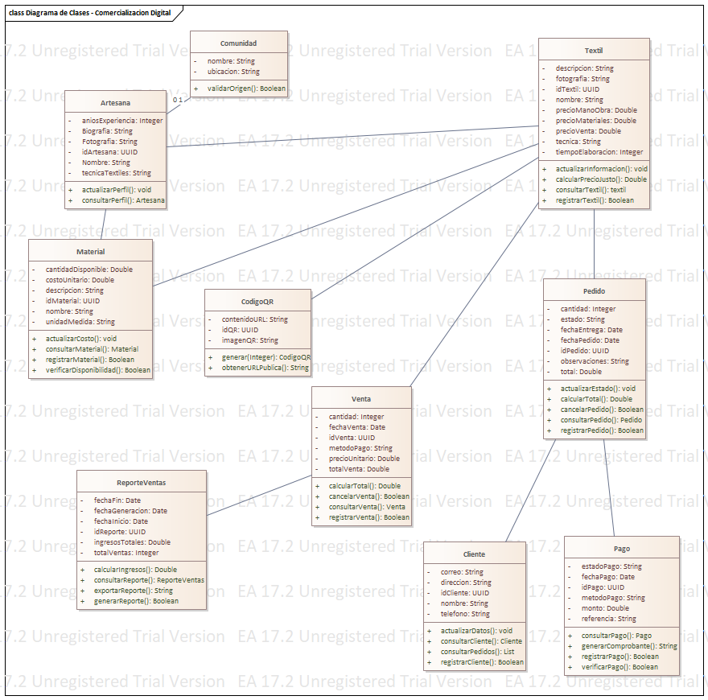

# Entrega · Práctica 9

<!--
Plantilla de entrega. Llenen cada sección con la información de su módulo.
- No cambien los títulos: el robot los usa para encontrar cada parte.
- Todo lo que está entre estos símbolos de comentario NO cuenta como contenido.
- Si prefieren entregar en PDF, exporten este mismo documento como entrega/practica-9.pdf
  y borren este archivo .md (el robot revisa el .md si existen los dos).
- El repositorio es público: no escriban teléfonos, correos ni CURP. Usen el cargo o rol.
-->

**Equipo:** Equipo Charlie  
**Módulo del Hub:** Módulo de gestión de entregas  
**Organización:** Open Hub Tec

## 1. Clases identificadas

<!-- Por cada clase: el sustantivo del DRS de donde sale y el requisito que la justifica.
Ejemplo:  | Entrega | "la encargada registra cada entrega de miel" | RF-03 | -->

| Clase | Sustantivo del DRS | Requisito |
|---|---|---|
| Entrega | "la encargada registra cada entrega de miel" | RF-03 |
| Socio | "el socio realiza la entrega de miel" | RF-01 |
| Productor | "el productor es quien entrega la miel" | RF-02 |
| Pago | "se registra el pago de la entrega" | RF-04 |
| Inventario | "se lleva el control del inventario de la miel" | RF-05 |

## 2. Atributos y tipos

<!-- Un renglón por clase con sus atributos y tipo. Ejemplo:  Entrega: fecha: Date, kilos: decimal -->

- Entrega: fecha: Date, kilos: decimal, observaciones: String
- Socio: idSocio: int, nombre: String, telefono: String, direccion: String
- Productor: idProductor: int, nombre: String, ubicacion: String, categoria: String
- Pago: idPago: int, fecha: Date, monto: decimal, metodo: String
- Inventario: idInventario: int, cantidadDisponible: decimal, fechaActualizacion: Date

## 3. Operaciones

<!-- Cada operación con parámetros y el RF del que sale.
Ejemplo:  Entrega.registrar(kilos: decimal): Entrega  ← RF-03 "registrar la entrega" -->

- Entrega.registrar(fecha: Date, kilos: decimal): Entrega ← RF-03 "registrar la entrega"
- Entrega.consultar(idEntrega: int): Entrega ← RF-03 "consultar la entrega"
- Socio.registrar(nombre: String, telefono: String): Socio ← RF-01 "registrar socio"
- Productor.registrar(nombre: String, ubicacion: String): Productor ← RF-02 "registrar productor"
- Pago.generar(monto: decimal, metodo: String): Pago ← RF-04 "generar pago"
- Inventario.actualizar(cantidad: decimal): Inventario ← RF-05 "actualizar inventario"

## 4. Encapsulamiento y visibilidad

<!-- Qué dejaron privado (−) y qué público (+), y por qué. -->

- Se mantienen privados los atributos que representan datos internos o sensibles del dominio, como:
  - `Socio.-idSocio`
  - `Productor.-idProductor`
  - `Entrega.-fecha`
  - `Pago.-idPago`
- Se exponen públicos los métodos de operación que deben ser invocados desde otros objetos o casos de uso:
  - `+registrar(...)`
  - `+consultar(...)`
  - `+generar(...)`
  - `+actualizar(...)`
- Esto permite encapsular el estado y controlar el acceso a la información, manteniendo la lógica del dominio dentro de cada clase.

## 5. Asociaciones y multiplicidad

<!-- Cada asociación leída como oración, con su multiplicidad.
Ejemplo:  Un Socio realiza 0..* Entregas; cada Entrega es de 1 Socio. -->

- Un Socio realiza 0..* Entregas; cada Entrega es de 1 Socio.
- Un Productor aporta 1..* Entregas; cada Entrega pertenece a 1 Productor.
- Una Entrega genera 1 Pago; cada Pago corresponde exactamente a 1 Entrega.
- Un Inventario gestiona 1..* Entregas; cada Entrega afecta a 1 Inventario.
- Un Socio puede gestionar 0..* Pagos; cada Pago es gestionado por 1 Socio.

## 6. Agregación, composición y herencia

<!-- Cuál usaron y por qué. Si no usaron ninguna, expliquen por qué su modelo no la necesita. -->

- Se usó composición para modelar la relación entre `Entrega` y `Pago`, porque el pago no tiene sentido sin la entrega asociada.
- Se usó agregación para modelar la relación entre `Inventario` y `Entrega`, ya que la entrega forma parte del inventario sin depender de una única instancia del mismo.
- No se usó herencia porque el dominio no presenta una jerarquía clara de especialización; los conceptos representados son entidades independientes con responsabilidades distintas.
- Si el dominio real de su equipo no requiere estas relaciones, se pueden justificar con la misma lógica: "no fue necesario porque no hay especialización ni agregados del negocio".

## 7. Trazabilidad

<!-- La misma información que docs/analisis/trazabilidad.csv: clase → requisito → parte del BPMN mejorado. -->

| Clase | Requisito | Actividad del BPMN |
|---|---|---|
| Entrega | RF-03 | Registrar entrega |
| Socio | RF-01 | Registrar socio |
| Productor | RF-02 | Registrar productor |
| Pago | RF-04 | Generar pago |
| Inventario | RF-05 | Actualizar inventario |

## 8. Diagrama y notación UML

<!-- Inserten el PNG exportado de Architect. Ejemplo:

Indiquen dónde está el .qea (modelo/OpenHub-Equipo.qea). -->

- Modelo de Architect: `modelo/OpenHub-Equipo.qea`
- Diagrama exportado: `docs/analisis/Diagrama_Clases_UML.png`

## 9. Trabajo en equipo

<!-- Quién hizo y quién revisó cada pull request. Ejemplo:  Ana: abrió #2 y #5; revisó #3. -->

| Integrante | Pull requests que abrió | Pull requests que revisó |
|---|---|---|
| Equipo Charlie | #1 | #1 |
| Integrante 1 | #1 | #2 |
| Integrante 2 | #2 | #1 |

## 10. Revisión cruzada

<!-- Equipo que los revisó, sus observaciones y qué hicieron con cada una (corregido o justificado). -->

| Observación del equipo revisor | Qué hicimos |
|---|---|
| El equipo revisor observó que algunas asociaciones no tenían multiplicidad completa, que la trazabilidad debía coincidir con los requisitos y que ciertas operaciones estaban asignadas a una clase incorrecta. Corregimos las multiplicidades, ajustamos la tabla de trazabilidad a los RF del BPMN y reubicamos las operaciones en las clases correspondientes. Revisamos los cambios para atender cada observación. |
